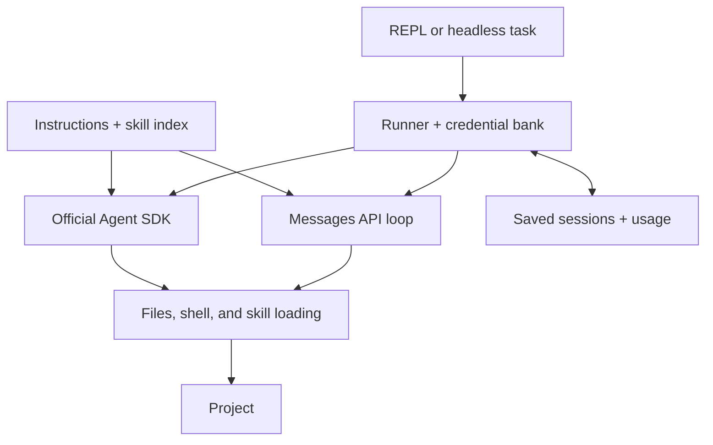

# ArnCode

[](package.json)
[](src/)
[](LICENSE)

A Claude coding agent with a credential bank for multiple accounts.

Mix API keys and OAuth tokens, track usage per account, and continue with another available credential when a rate limit or subscription window runs out. ArnCode keeps the task's conversation context as it switches accounts.

Full access is the default: files and shell commands run without approval prompts. Use `--safe` to ask before changes. Run ArnCode in a VM, container, or sandbox; a [Docker example](#run-in-a-container) is included below.

[Quickstart](#quickstart) · [Credential bank](#credential-bank) · [Skills](#skills-and-project-instructions) · [CLI reference](docs/reference.md) · [Contributing](CONTRIBUTING.md)

## Quickstart

Requires Node.js 20.19 or newer and Bash. Use Linux, macOS, or Windows through WSL.

Clone this repository, then install from its directory:

```sh
npm ci
npm run build
npm link
```

Start in the project you want to work on:

```sh
cd /path/to/project
arncode
```

On first launch in a terminal, ArnCode offers credential setup if none are available. Add an API key or a long-lived OAuth token obtained with `claude setup-token` in the official Claude CLI. Credential input is hidden.

```sh
arncode -p "Find the cause of the failing tests and fix it"
arncode --continue
```

## Credential bank

Add as many API keys and OAuth accounts as you need. Set their order, see what each account has used, and let ArnCode select an available credential for the next request.

```sh
arncode creds add personal --type oauth --priority 0
arncode creds add work --type api-key --priority 10
arncode creds list
arncode creds usage
```

Lower priority numbers go first. The bank records requests, input/output/cache tokens, estimated costs, errors, limit hits, and reset times per credential. `creds list` shows names, types, masked suffixes, and availability.

When an account hits a rate limit, a 5-hour or weekly subscription limit, a billing failure, or an authentication failure, ArnCode marks it unavailable and tries the next healthy credential. Provider reset times take precedence over fallback cooldowns. Credentials become eligible again after their reset time; if every credential is unavailable, ArnCode saves the session and explains when you can retry.

```sh
arncode auth use personal       # Prefer an account; still allow failover
arncode --auth api-key          # Use only API keys
arncode --auth oauth            # Use only OAuth accounts
arncode --credential work       # Pin one account; disable failover
```

`--profile` aliases `--credential`. `ANTHROPIC_API_KEY` and `CLAUDE_CODE_OAUTH_TOKEN` also work as environment fallbacks without being copied into the bank.

API-key mode uses ArnCode's own Messages API loop. OAuth uses the official Claude Agent SDK, with competing API-key credentials removed from its environment. Switching between engines carries the transcript as context; long histories are bounded, and hidden thinking does not transfer. See [authentication and failover](docs/reference.md#authentication-and-failover) for selection rules and limits.

## Terminal workflow

Responses stream as they arrive. Tool summaries, file diffs, and usage appear alongside the conversation. Saved sessions support `--continue` for the current project and `--resume <id>` for a specific conversation in that same project. Use `--cwd` when resuming from another directory.

```sh
arncode --cwd /path/to/project
arncode -p "Add a regression test for empty input"
printf 'Find unused exports\n' | arncode
arncode -p < task.txt
arncode --model claude-haiku-5-5 --effort low -p "List the entry points"
```

Assistant text goes to stdout; progress, tools, diffs, and usage go to stderr. Piped input works without a TTY. In interactive sessions, a status bar shows the model, effort, mode, context use, plan usage, credential, and cost. You can type the next request while the agent works; Esc interrupts it. `/help`, `/model`, `/effort`, `/mode`, `/plan`, `/fast`, `/auth`, `/clear`, `/cost`, `/creds`, `/usage`, and `/exit` control the session; Tab completes commands and `@` file mentions. Replies render as Markdown with highlighted code, and Markdown files in `.arncode/commands/` or `.claude/commands/` become your own slash commands. [Hooks](docs/reference.md#hooks) and [MCP servers](docs/reference.md#mcp-servers) use the same formats as Claude Code.

The agent keeps a checklist for multi-step work, hands broad searches to subagents that run in parallel (read-only explorers use Claude Haiku 5.5 by default), and can search and fetch the web. Both modes can look at images and read PDFs. Reading a PNG, JPEG, GIF, or WebP file (a screenshot or a rendered frame) shows it to the model, and `@path` mentions or pasted image paths in a prompt attach the file directly. Large images are downscaled before they are sent.

The default model is `claude-opus-5-5`, with adaptive thinking and medium effort. Fast mode, prompt caching, bounded output, and finite retry/turn limits are supported. See the [full command reference](docs/reference.md#command-line-options).

## Full access and optional approvals

The default `full` mode runs tools without prompts. Three other modes ask first:

- `edits` applies file edits automatically and asks before shell commands.
- `ask` (`--safe`, `--ask`) asks before every write, edit, and shell command.
- `plan` (`--plan`) keeps the project read-only while the agent explores and proposes a plan; shell commands need approval. When you approve the plan, you choose the mode it continues in.

Press Shift+Tab to cycle modes, or use `--permission-mode <mode>` and `/mode <mode>`. Approvals offer once, for the rest of the session, or no. Without a terminal, actions requiring approval are denied immediately.

`--yolo` and `--dangerously-skip-permissions` remain accepted aliases for full mode. Set `"permissionMode"` in configuration to make another mode your preference.

Shell commands have your account's filesystem and network access. Approval prompts are not a sandbox. API file tools stay within the selected project; shell commands can reach beyond it. API shell processes have bounded output and timeouts, and their managed process groups are stopped on completion or cancellation. OAuth uses the SDK's native tools with the same selected permission mode.

## Run in a container

Build the included [Dockerfile](Dockerfile), then mount the project you want to edit:

```sh
docker build -t arncode .
cd /path/to/project
docker run --rm -it \
  --mount type=bind,src="$PWD",dst=/work \
  --mount type=volume,src=arncode-state,dst=/home/node/.arncode \
  arncode
```

The image runs as the non-root `node` user and includes Bash, Git, and FFmpeg. The project must be writable by UID 1000. The named volume preserves the credential bank and sessions between runs. Mount only the project you intend to edit; use a VM when you need stronger isolation.

## Skills and project instructions

Skills keep reusable procedures available without filling every prompt with their full text. ArnCode initially loads only each skill's name and description, then reads the body through the `skill` tool when it is needed. Both API-key and OAuth modes receive the same catalog.

Save a skill as `.arncode/skills/review-change/SKILL.md` in a project:

```md
---
name: review-change
description: Review a change for behavior regressions and missing validation.
---

Read the diff and its surrounding code. Check the affected user journey and run
relevant existing tests. Report concrete defects with file locations.
```

Then ask: `Use review-change to review the staged diff.`

Global skills live in `~/.arncode/skills`. The compatible project and global `.claude/skills` locations are also discovered. Project skills take precedence over global ones; `.arncode` takes precedence over `.claude` within each scope.

Always-applicable instructions come from global `~/.arncode/AGENTS.md` and the project's root `AGENTS.md` and `CLAUDE.md`. API-key requests cache the stable system/tool prefix and move a conversation cache breakpoint forward as the task progresses. Cache reuse follows the provider's TTL and minimum-length rules. Large tool results and conversation context are bounded; full skill bodies stay out of the initial prompt. See [prompt caching](docs/reference.md#prompt-caching) for details.

## Storage and usage

Credentials, preferences, usage, and saved conversations live under `~/.arncode`, outside the project. The directory uses mode `700`; private JSON files use mode `600` and atomic writes. `ARNCODE_CONFIG_DIR` selects another location outside Git repositories.

Registered secrets and Anthropic token patterns are redacted from output and saved conversations. Native SDK session logging is disabled; OAuth resumes from ArnCode's redacted transcript. OAuth also records streamed token usage before completion and reconciles it with the final SDK result; interrupted runs retain observed tokens with cost unavailable.

File and search tools exclude protected paths in both auth modes. Defaults cover `~/.arncode`, `~/.secrets`, `~/.ssh`, `**/.env`, and `**/.env.*`, including `.env.example`. Add project-relative paths or patterns with `protectedPaths` in configuration; defaults and the active state directory remain protected. See [protected paths](docs/reference.md#protected-paths) for matching rules. Shell commands still have your account's access; these exclusions are not a sandbox.

`/cost` shows session usage; `/usage` and `arncode creds usage` show per-credential totals, separating uncached input, output, cache reads, and cache writes. Costs are estimates, not invoices or remaining subscription quota. Unknown pricing and custom endpoints report unpriced usage. See [configuration and storage](docs/reference.md#configuration-and-storage) for file locations and environment variables.

## Architecture



[`src/runner.ts`](src/runner.ts) selects credentials and coordinates context, metering, and failover. [`src/engines/api.ts`](src/engines/api.ts) runs the Messages API loop with ArnCode's tools; [`src/engines/oauth.ts`](src/engines/oauth.ts) integrates the SDK's native tools and the shared skill loader. Permissions, streaming UI, redaction, and private storage are shared modules.

The integrations follow Anthropic's [Messages API](https://platform.claude.com/docs/en/api/messages), [tool-use protocol](https://platform.claude.com/docs/en/agents-and-tools/tool-use/overview), and [Agent SDK](https://code.claude.com/docs/en/agent-sdk/overview). Cost estimates use [published pricing](https://platform.claude.com/docs/en/about-claude/pricing), with assumptions recorded in source.

## Roadmap

Planned work:

- Token-aware conversation summaries for longer sessions.
- Optional web retrieval and additional tool integrations.
- More commands for inspecting and exporting sessions.
- Windows process management without WSL.

## Contributing

See [CONTRIBUTING.md](CONTRIBUTING.md) for setup, verification, and reporting bugs. Automated tests use mocked providers and temporary directories; they do not make paid API requests.

## License

ArnCode is [MIT licensed](LICENSE). Dependencies retain their own licenses; the [Claude Agent SDK](https://github.com/anthropics/claude-agent-sdk-typescript) is distributed under Anthropic's separate terms.
